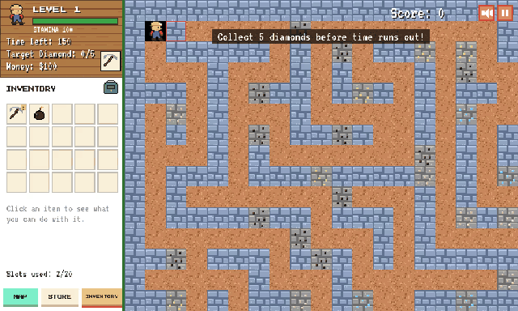
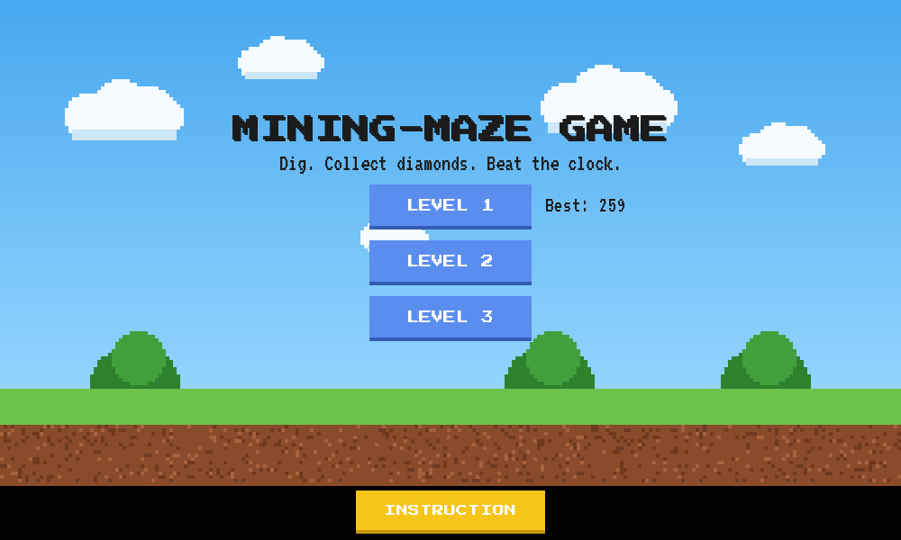
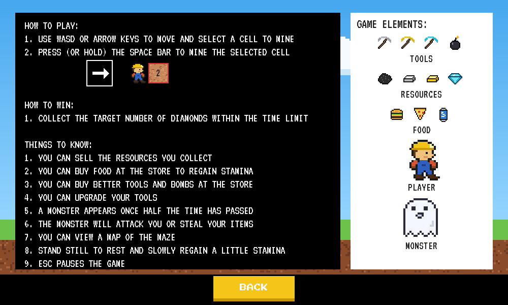
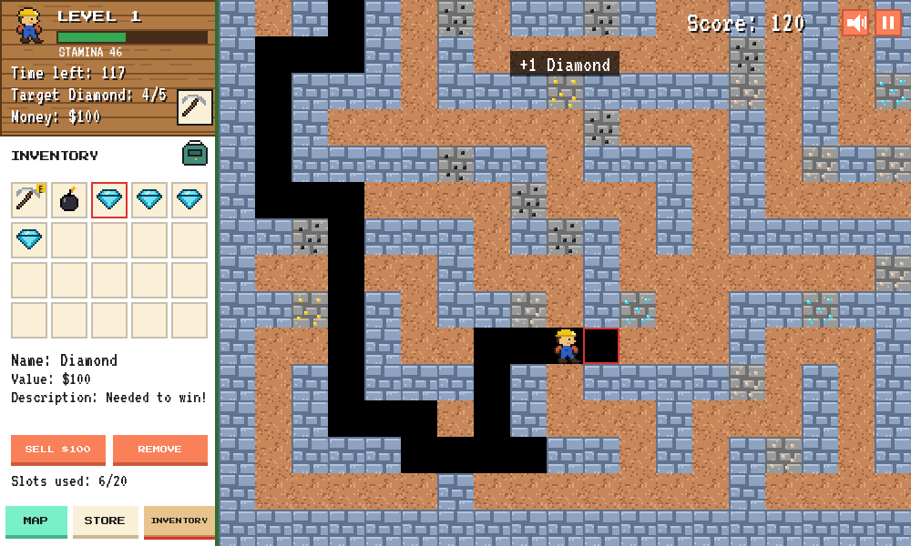
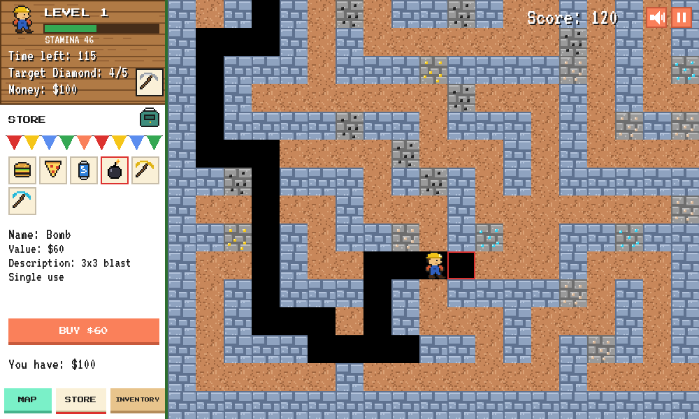
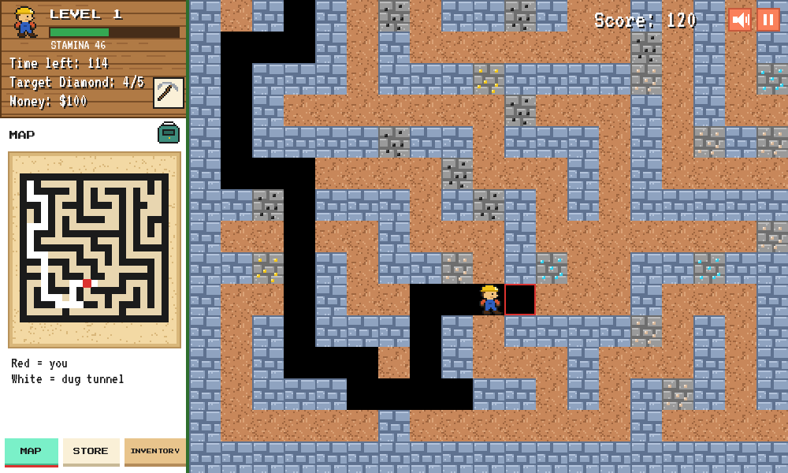
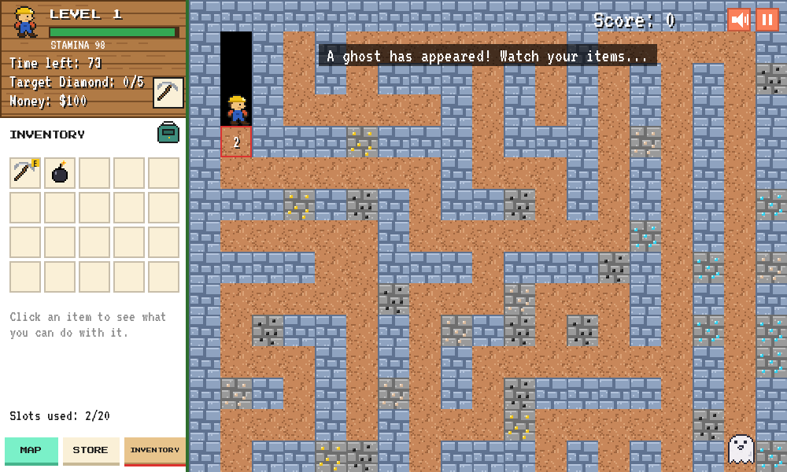
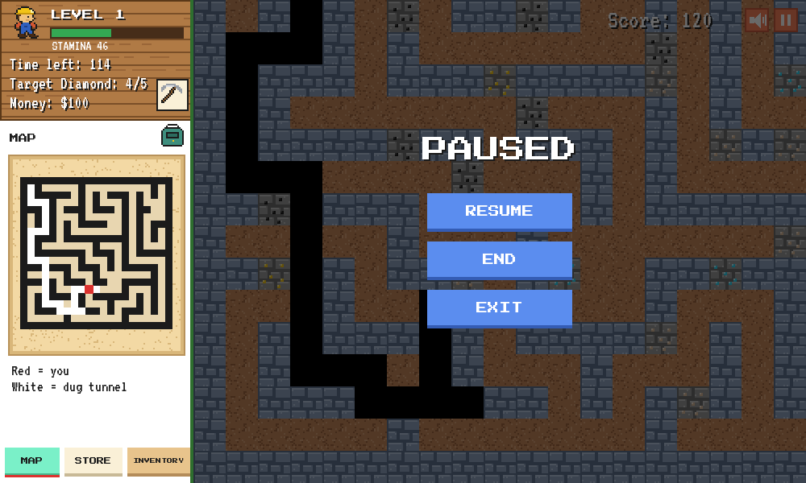
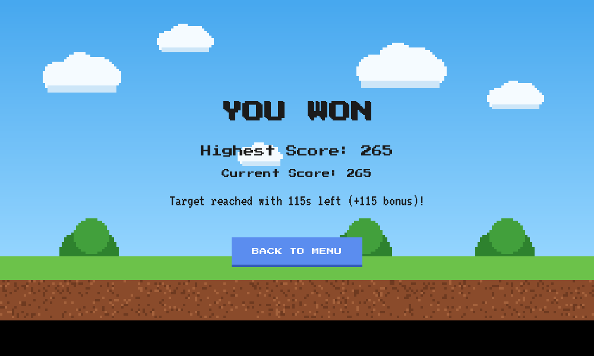
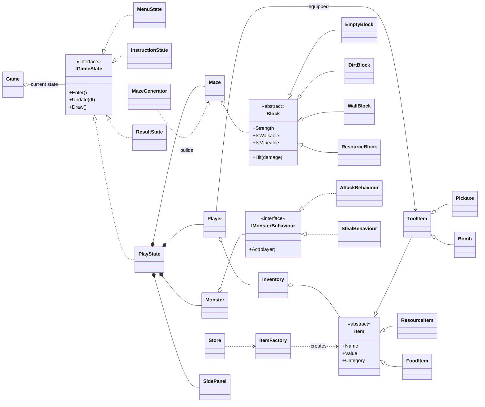

# ⛏️ Mining-Maze Game


> A 2D pixel-art mining game written in **C#** with **SplashKit**. Dig through a randomly generated underground maze, mine coal, iron, gold and diamonds, manage your stamina and money, dodge a thieving ghost, and collect the target number of diamonds before time runs out.

<p align="center">
  
  <br><sub>A full Level 1 run, recorded from the game (sped up 1.6×)</sub>
</p>

> **About this repository:** this is a rebuild of my **COS20007 Object-Oriented Programming** project (Sep–Dec 2024), recreated from the original game design and documentation. The original version received the **top-scorer award** for the unit. This rebuild was written with the help of an AI coding assistant.

---

## 🎮 Gameplay

| | |
|---|---|
| 🎯 **Goal** | Collect the target number of diamonds before the timer runs out |
| ⛏️ **Mining** | Face a block with **WASD / arrow keys**, then press or hold **Space**. Every block has a *strength*, and each hit removes as much strength as your tool's *efficiency*. |
| 🧱 **The maze** | Stone walls can't be mined. Dirt paths must be dug through. Ore is embedded in the walls along the paths. |
| ⚡ **Stamina** | Every swing costs stamina. Eat food to refill it, or stand still to rest a little. |
| 💰 **Economy** | Sell resources for money. Buy food, bombs and better pickaxes, or upgrade the one you have. |
| 👻 **The ghost** | Appears once half the time has passed. It floats through walls, then either **attacks** (−20 stamina) or **steals an item**. |
| 🗺️ **Map** | Shows the whole maze, your position, the tunnels you've dug and the ghost |

### Three difficulty levels

| Level | Maze | Time | Target 💎 | Diamonds in maze | Ghost speed |
|---|---|---|---|---|---|
| 1 | 21 × 21 | 150 s | 5 | 8 | slow |
| 2 | 31 × 31 | 210 s | 10 | 15 | medium |
| 3 | 41 × 41 | 270 s | 15 | 22 | fast |

### Controls

| Input | Action |
|---|---|
| `W` `A` `S` `D` / arrow keys | Move, and turn to select the cell to mine |
| `Space` (tap or hold) | Mine the selected cell |
| Mouse | Menus, inventory, store, map, sound and pause buttons |
| `Esc` | Pause / resume |
| `F12` | Save a screenshot |

---

## 📸 Screenshots

| Main menu | Instructions |
|---|---|
|  |  |
| **Inventory:** use, upgrade, sell, eat or remove | **Store:** food, bombs and better pickaxes |
|  |  |
| **Map:** red is you, white is dug tunnel | **The ghost appears halfway through** |
|  |  |
| **Pause menu** | **Win screen** with the saved high score |
|  |  |

---

## 🏗️ Object-oriented design

The code is split into **game logic** (items, world, entities) and **presentation** (states, UI). The logic classes never call SplashKit, so they can be tested without a window.



### Design patterns used

| Pattern | Where | Why |
|---|---|---|
| **State** | `IGameState` → `MenuState`, `InstructionState`, `PlayState`, `ResultState`, switched by `Game.ChangeState()` | Each screen owns its own update and draw logic. There's no giant `switch` in the main loop. |
| **Factory** | `ItemFactory.Create(ItemKind)`, `BlockFactory.Create(BlockType)`, `LevelFactory.Create(level)` | Prices, strengths and level settings live in one place. The store, the mining code and the maze generator never call constructors directly. |
| **Strategy** | `IMonsterBehaviour` → `AttackBehaviour`, `StealBehaviour` | The ghost picks a behaviour at run time. Adding a new one (e.g. "freeze") needs no change to `Monster`. |
| **Singleton** | `SoundManager.Instance` | One shared owner of every sound and the mute setting |
| **Observer** | `Player.ItemCollected` event (C# `event`) | The play screen reacts to collected items (messages) without the player knowing about the UI |

Other OOP principles: **inheritance and polymorphism** (`Block` and `Item` hierarchies, overridden `IsWalkable`, `Details`, `CanUpgrade` and so on), **encapsulation** (private setters, read-only inventory view), and **abstraction** (abstract base classes and interfaces).

### Maze generation
Each game builds a new maze. A **depth-first recursive backtracker** (with an explicit stack) carves dirt paths between stone walls, then opens a few extra gaps to create loops. Ore is embedded only in wall cells that touch a path, so it can always be reached. Diamonds are placed in the half of the maze furthest from the start, so you have to explore.

---

## 🚀 Build & run

**Requirements:** the [.NET 8 SDK](https://dotnet.microsoft.com/download) and [SplashKit](https://splashkit.io/installation/). The project uses the `SplashKit` NuGet package, and SplashKit's installer sets up its native library.

```bash
git clone https://github.com/kfahchai-netizen/COS20007-MINING-MAZE-GAME.git
cd COS20007-MINING-MAZE-GAME
dotnet run
```

High scores are saved to `highscores.txt` next to the game.

## 🧪 Tests

`tests/LogicTests.cs` checks the game rules without opening a window. It also runs a **bot that plays all three levels** on random mazes, as a check that every level can be won:

```bash
mcs -out:tests.exe tests/LogicTests.cs src/Items/*.cs src/World/*.cs src/Entities/*.cs
mono tests.exe        # or compile the same files into a small dotnet console project
```

What it checks: maze size, border and ore reachability · item prices, buying, eating, selling and upgrading · inventory capacity · bomb blast radius · walls blocking movement · ghost attack, steal and pathing · a bot winning levels 1–3. The bot was run on **40 random mazes per level** while the game was being balanced.

## 📁 Project structure

```
├── src/
│   ├── Program.cs
│   ├── Core/       Game loop & state switching, assets, sound (singleton), high scores, UI helpers
│   ├── States/     MenuState, InstructionState, PlayState, ResultState
│   ├── UI/         SidePanel: stats board + inventory / store / map tabs
│   ├── World/      Blocks, Maze, MazeGenerator, LevelConfig
│   ├── Entities/   Player, Monster + IMonsterBehaviour strategies
│   └── Items/      Item hierarchy, ItemFactory, Inventory, Store
├── Resources/      images/, sounds/, fonts/ (all loaded by name at start-up)
├── tests/          LogicTests.cs (headless rule tests + bot), SplashKitStub.cs (compile-only stub)
├── tools/          make_assets.py: generates every sprite, tile, background and sound
└── docs/           Screenshots and gameplay GIF
```

## 🎨 Assets & credits

- **All sprites, tiles, backgrounds and sound effects are original.** They are drawn and synthesised in code by `tools/make_assets.py` (Python + Pillow), so there's no third-party art.
- Fonts: [Press Start 2P](https://fonts.google.com/specimen/Press+Start+2P) and [VT323](https://fonts.google.com/specimen/VT323), both under the SIL Open Font License (licence files are in `Resources/fonts/`).
- Built with [SplashKit](https://splashkit.io/) by Swinburne University of Technology.

---

<sub>Made by **Kean Fah Chai** · Swinburne University of Technology Sarawak · COS20007 Object-Oriented Programming</sub>
